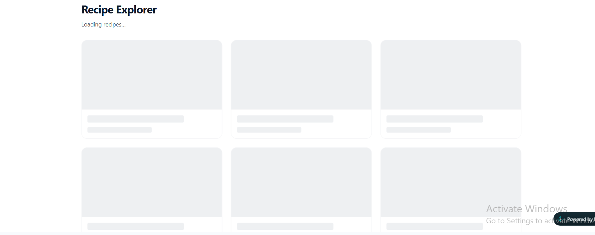
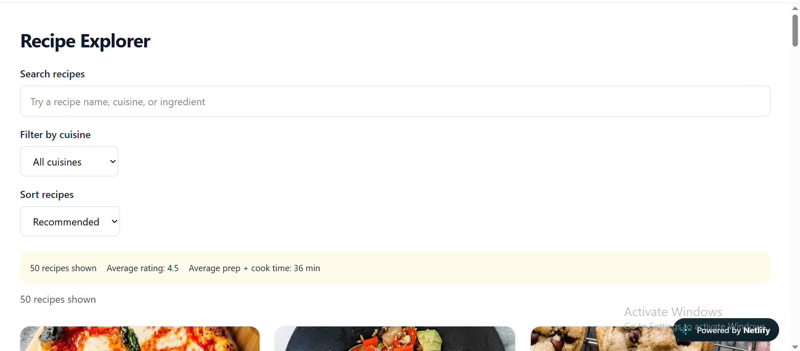
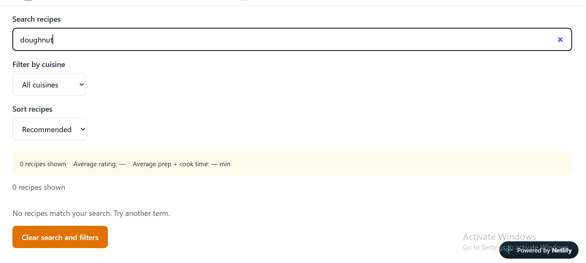

# Recipe Explorer

A single-page app for discovering recipes from around the world. Search by recipe name, cuisine, or ingredient; filter by cuisine; sort the results; and open a recipe to see its details.

## Project links

- **Student name:** Umutoni Dinah
- **API:** [DummyJSON Recipes](https://dummyjson.com/docs/recipes)
- **GitHub repository:** [week5-async-data-explorer](https://github.com/umutoni-dinah/week5-async-data-explorer)
- **Live app:** [Recipe Explorer](https://week5-async-data-explorer.netlify.app)
- **Video walkthrough:** https://drive.google.com/file/d/16YcVzdclVFBgDAXZHRyj36kzOilrSGS9/view?usp=sharing

## Features

- Loads recipes and recipe tags in parallel using `Promise.all`.
- Displays loading skeletons while data is being fetched.
- Shows a friendly error message and Retry button if a request fails.
- Searches recipe names, cuisines, and ingredients as you type.
- Filters by cuisine options created from the loaded recipe data.
- Sorts by name, rating, or preparation time using `toSorted()`.
- Opens a keyboard-accessible details dialog with ingredients and instructions.
- Shows average recipe rating and average total preparation and cooking time.
- Displays an empty state with a button to clear the search and filters.
- Uses labeled controls, image alt text, `aria-live`, and safe text rendering.

**Bonus:** No bonus feature implemented yet.

## State and rendering

The app keeps its interface data in one state object:

```js
{
  items: [],
  tags: [],
  status: "loading",
  error: null,
  query: "",
  filter: "all",
  sort: "default",
  selectedRecipe: null,
  detailStatus: null,
  detailError: null
}
```

Events update this state and call `render(state)`. The render function builds the page from the current state. Search, filtering, and sorting use the recipes already in state, so those actions do not make additional list requests. Selecting a recipe makes a separate request for its full details.

## Example API response and data transformation

A shortened example of a recipe returned by the API:

```json
{
  "id": 1,
  "name": "Classic Margherita Pizza",
  "ingredients": [
    "Pizza dough",
    "Tomato sauce",
    "Fresh mozzarella cheese"
  ],
  "prepTimeMinutes": 20,
  "cookTimeMinutes": 15,
  "difficulty": "Easy",
  "cuisine": "Italian",
  "image": "https://cdn.dummyjson.com/recipe-images/1.webp",
  "rating": 4.6
}
```

The app uses `map()` to build recipe cards and cuisine choices. It uses `find()` to locate a selected recipe in the loaded data before requesting its full details. `filter()` matches recipes to the search and selected cuisine, while `toSorted()` sorts a copy of the visible recipes without changing the original array. `reduce()` calculates the average rating and average total preparation and cooking time.

## Screenshots
### Loading


### Success


### Empty


### Error


## What I learned about async JavaScript

I learned that `fetch()` returns a promise, so `async` and `await` help me work with API responses in order. I learned to check `response.ok` because an unsuccessful HTTP response does not automatically throw an error. I used `Promise.all` to request recipes and tags at the same time. I learned to show a loading state while a request is running and an error state if it fails. Keeping interface data in one state object helps the page stay consistent when someone searches, filters, or sorts. Fetching one recipe’s full details only when its card is opened avoids requesting every detail upfront.

## Run locally

1. Clone the repository:

   ```bash
   git clone https://github.com/umutoni-dinah/week5-async-data-explorer.git
   ```

2. Open the project folder and install dependencies:

   ```bash
   npm install
   ```

3. Start the Vite development server:

   ```bash
   npm run dev
   ```

4. Open the local URL shown in the terminal.